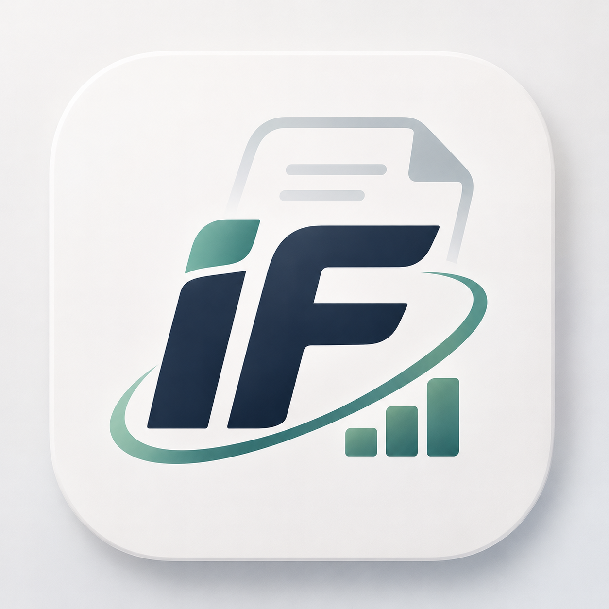
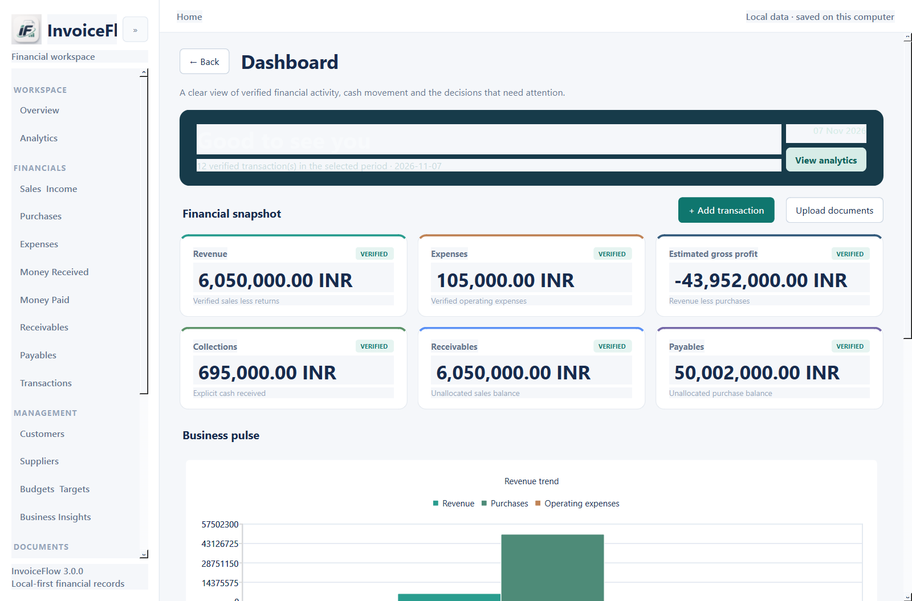
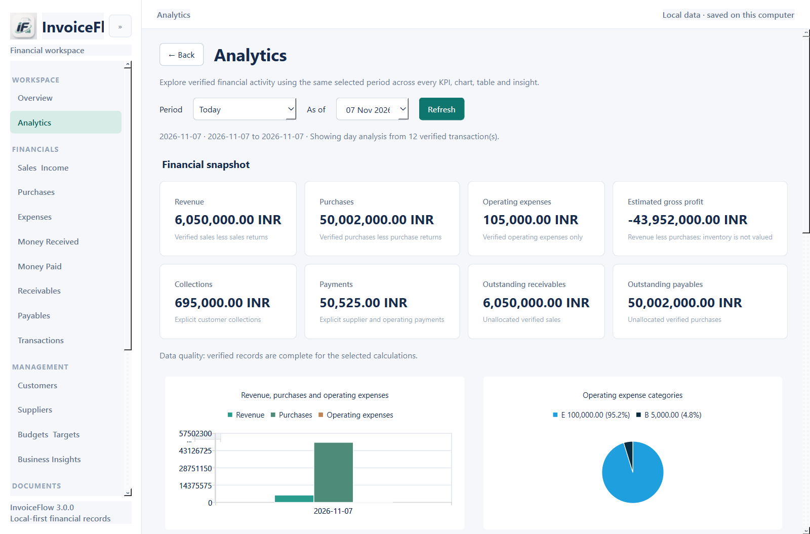
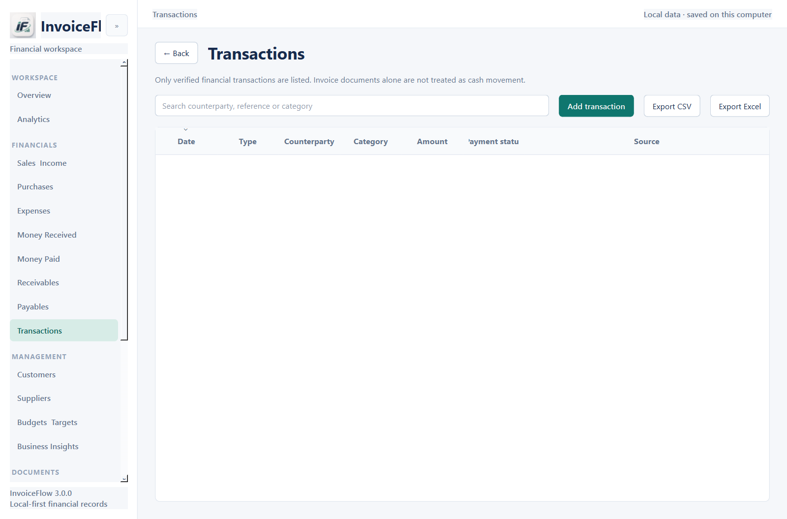
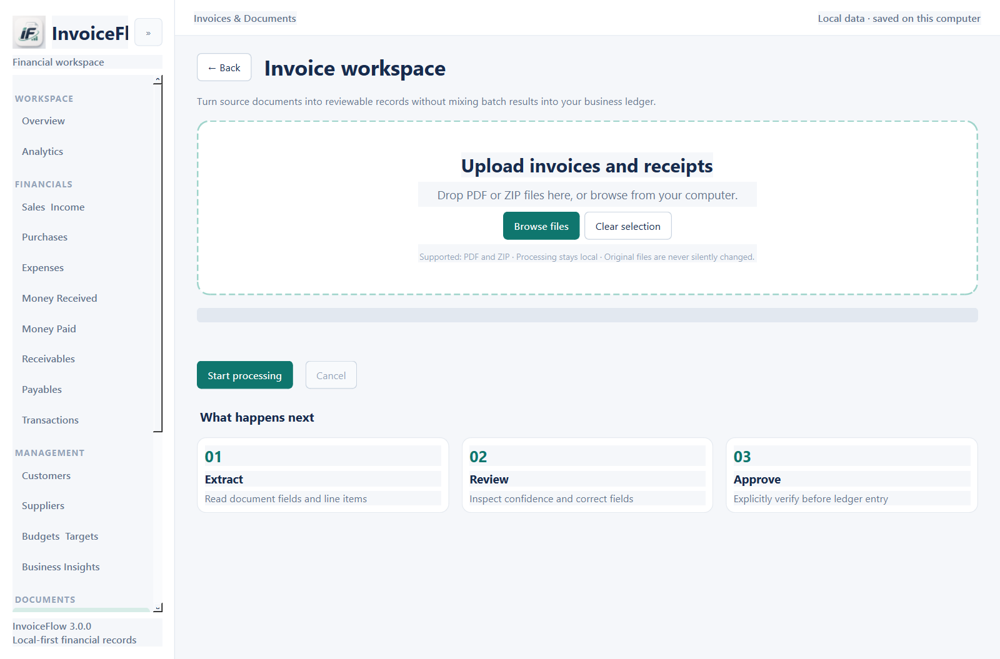
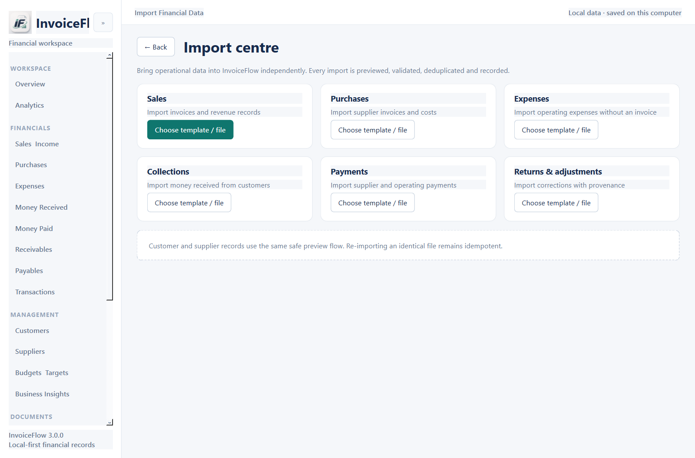

<div align="center">



# InvoiceFlow

**Your business's financial intelligence layer.**

Understand every rupee, without changing the software you already use.

[](https://github.com/rox-rohit/Invoiceflow/releases/tag/v3.0.0)
[](https://www.python.org/)
[](https://github.com/rox-rohit/Invoiceflow/releases)

</div>

InvoiceFlow is a native Windows desktop application for small businesses that need to process financial documents, organize verified transactions, and understand business performance. It works alongside existing invoicing and accounting software rather than requiring a replacement.

## What InvoiceFlow does

- **Process invoices:** Extract text, invoice fields, and line items from text-based PDF invoices.
- **Manage financial activity:** Record and review sales, purchases, expenses, collections, payments, returns, and adjustments.
- **Track payment status:** Allocate customer collections and supplier payments to invoices, including partial and multiple allocations.
- **Organize business contacts:** Maintain customer and supplier records with transaction history and balances.
- **Understand performance:** Review verified KPIs, revenue and expense trends, cash movement, category breakdowns, budgets, and business insights.
- **Import data safely:** Preview and validate CSV/XLSX data, detect duplicates, preserve provenance, and retain import history.
- **Export and protect data:** Export supported records to CSV, XLSX, or JSON and create verified SQLite backups.
- **Work comfortably:** Use light, dark, or system appearance modes, persistent navigation preferences, and first-launch onboarding.

Financial figures remain traceable to source records. Invoice revenue is not treated as a collection, purchases are not treated as payments, and unverified or insufficient data is not presented as verified profit.

## Screenshots

The repository includes native Windows captures from the running 3.0 application. Clean-machine Windows acceptance remains a separate release limitation.

### Dashboard



### Analytics



### Transactions



### Invoice upload and import centre





### Dark mode


## Windows installation

1. Open the [InvoiceFlow 3.0.0 release](https://github.com/rox-rohit/Invoiceflow/releases/tag/v3.0.0).
2. Download `InvoiceFlow_Setup_3.0.0.exe` and verify it against `SHA256SUMS.txt`.
3. Run the installer and choose the installation directory.
4. Launch InvoiceFlow from the Start Menu or optional desktop shortcut.

The installer contains the complete PyInstaller onedir application, including the Python runtime, Qt libraries, plugins, and approved InvoiceFlow branding. Python is not required on the target machine.

User data is stored outside the installation directory:

```text
%LOCALAPPDATA%\InvoiceFlow\history.db
```

Upgrades and uninstall remove application files but are designed to preserve this user database. Close InvoiceFlow before upgrading so locked files can be replaced safely.

## Development setup

InvoiceFlow is developed and tested on Windows. Python 3.12 or 3.13 is recommended for the current PySide6 and PyInstaller dependency ecosystem.

```powershell
git clone https://github.com/rox-rohit/Invoiceflow.git
cd Invoiceflow
py -3.12 -m venv .venv
.\.venv\Scripts\Activate.ps1
python -m pip install --upgrade pip
python -m pip install PySide6 PyMuPDF reportlab openpyxl pytest
python main.py
```

Run the regression suite:

```powershell
python -m pytest -q
```

Build the preferred Windows onedir package:

```powershell
powershell -ExecutionPolicy Bypass -File packaging\windows\build_windows.ps1
```

Build the versioned 3.0.0 package and Inno Setup installer when Inno Setup 6 is installed:

```powershell
powershell -ExecutionPolicy Bypass -File packaging\windows\build_windows.ps1 `
  -OutputName InvoiceFlow_3.0.0 -Version 3.0.0 -Installer
```

## Architecture

- **Native GUI:** PySide6 widgets, QtCharts, shared components, theme handling, navigation, dialogs, and onboarding.
- **Application logic:** Python modules for invoice processing, imports, ledger operations, allocations, aging, analytics, reports, exports, backups, and audit history.
- **Persistence:** SQLite in the per-user local application data directory with additive, repeatable migrations.
- **Document processing:** PyMuPDF text and word-coordinate extraction with deterministic parsing, validation, duplicate checks, and review states.
- **Packaging:** PyInstaller onedir distribution followed by an Inno Setup Windows installer.

InvoiceFlow does not use a web frontend or require a browser service to run.

## Privacy and data handling

InvoiceFlow is local-first. Financial records, import history, audit history, and application settings are stored in the local SQLite database described above. The application does not require a hosted backend or browser connection for normal operation.

Users remain responsible for protecting their Windows account, database backups, imported documents, and exported files. Do not commit databases, private invoices, credentials, or customer data to source control.

## Project status and roadmap

### Implemented in 3.0.0

- Native Windows desktop shell and persistent grouped navigation.
- Invoice processing, review states, duplicate detection, and source-document provenance.
- Verified transaction ledger with payment allocation and reversal safeguards.
- Customer and supplier management.
- CSV/XLSX import preview, validation, duplicate detection, and import history.
- Analytics, reports, budgets, aging, exports, backups, onboarding, and theme preferences.
- Centralized design tokens, redesigned dashboard surfaces, import workspace, and improved dark-mode chart contrast.

### In progress

- Broader visible Windows acceptance at multiple resolutions and on clean Windows environments.
- Further refinement of page-level layouts, chart presentation, and batch-results review workflows.

### Planned or deliberately deferred

- OCR for scanned PDFs.
- Calibrated machine-learning categorization.
- Additional accounting integrations and hosted collaboration features.

## Known limitations

- OCR is not included; scanned PDFs are flagged for OCR review.
- Extraction is deterministic and should be reviewed for unfamiliar invoice layouts.
- Repository screenshots are native captures from the development Windows session; clean-machine visual acceptance remains outstanding.
- Clean Windows 10/11 virtual-machine testing has not been completed.
- This release does not claim full accounting, tax, or statutory-compliance coverage.

## License

InvoiceFlow is copyright © 2026 Rohit Ahirwar. The repository currently includes an all-rights-reserved `LICENSE`; no permission is granted to redistribute or modify the software unless separately authorized.

## Contributing

Please open an issue before proposing substantial changes. Contributions should preserve financial traceability, database compatibility, user-data safety, and the native PySide6 architecture. Run the regression suite before submitting a change.

## Author and support

**Rohit Ahirwar**

- GitHub: [@rox-rohit](https://github.com/rox-rohit)
- Project: [github.com/rox-rohit/Invoiceflow](https://github.com/rox-rohit/Invoiceflow)
